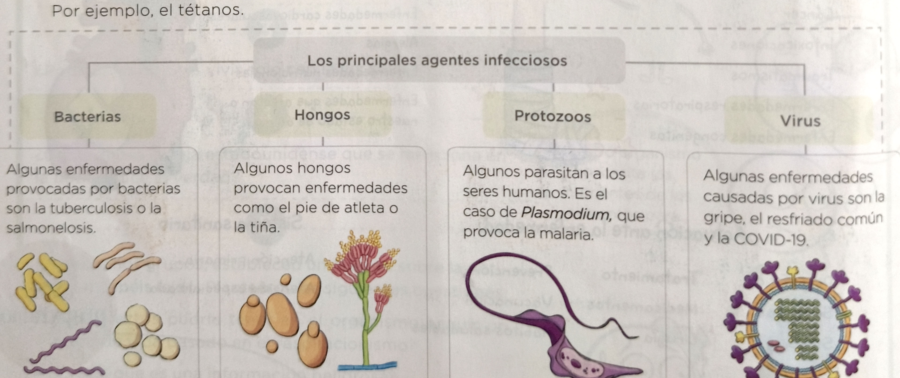
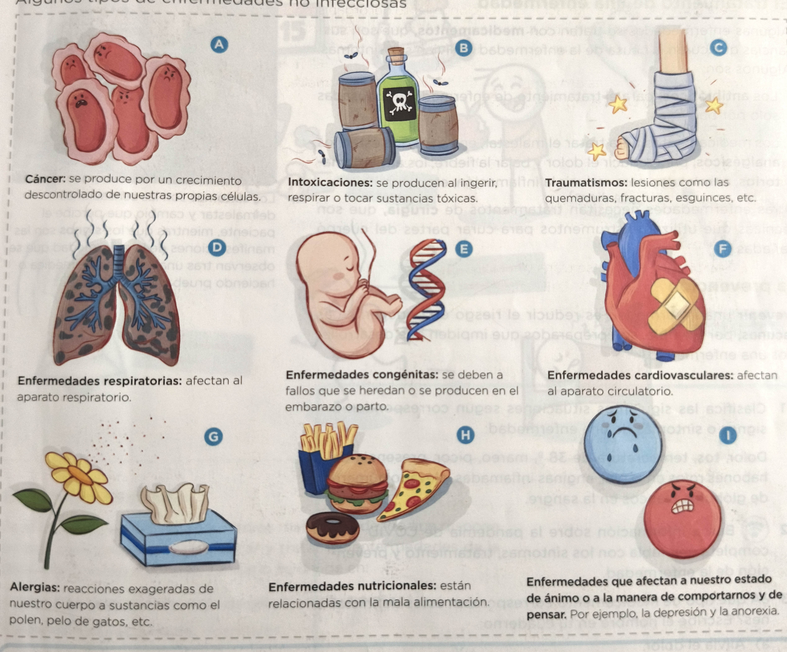
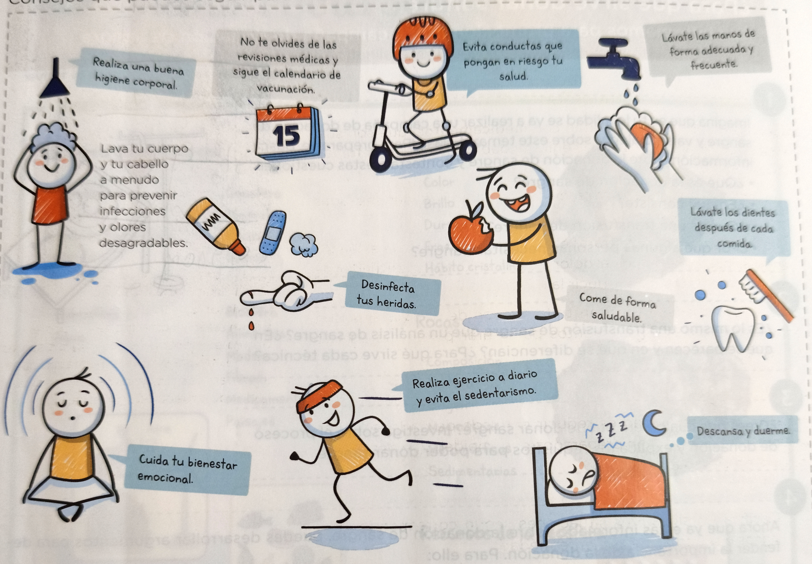

# Unidad Didáctica: Salud y Enfermedades

*Transcripción OCR Completa, Exacta e Ilustrada del Libro de Texto*

## 1. ¿Qué significa tener salud? ¿Qué enfermedades nos pueden afectar?

### 1.1 La salud y la enfermedad

La **salud** es un estado de completo bienestar físico, mental y social. Los factores que más influyen en nuestra salud son: la edad, nuestro estilo de vida, nuestro entorno y la salud pública.

> 💡 **Sanidad Pública y Salud**
> La sanidad pública del lugar en el que vivimos afecta a nuestra salud. Por ejemplo, el control sanitario de los alimentos, el calendario de vacunación, etc.

La **enfermedad** es una alteración del funcionamiento del organismo o de alguna de sus partes debida a una causa interna o externa, que se mantiene durante un período de tiempo.

Según las causas que las provocan, existen dos tipos de enfermedades: las **infecciosas** y las **no infecciosas**.

### 1.2 Las enfermedades infecciosas

Son las que están provocadas por los **agentes infecciosos**, seres vivos muy pequeños que entran en nuestro cuerpo y alteran su funcionamiento. Los agentes infecciosos pueden entrar en nuestro cuerpo a través de heridas, por el aire o por la boca. Existen dos tipos de enfermedades infecciosas:

- Las **contagiosas**: se transmiten de unas personas a otras. Por ejemplo, la gripe, la COVID-19 o el sarampión.
- Las **no contagiosas**: no se transmiten de unas personas a otras. Por ejemplo, el tétanos.

#### Los Principales Agentes Infecciosos

*Figura 1: Clasificación y ejemplos de los principales agentes infecciosos (Bacterias, Hongos, Protozoos y Virus).*

| Agente Infeccioso | Descripción y Ejemplos de Enfermedades |
|---|---|
| Bacterias | Algunas enfermedades provocadas por bacterias son la tuberculosis o la salmonelosis. |
| Hongos | Algunos hongos provocan enfermedades como el pie de atleta o la tiña. |
| Protozoos | Algunos parasitan a los seres humanos. Es el caso de *Plasmodium*, que provoca la malaria. |
| Virus | Algunas enfermedades causadas por virus son la gripe, el resfriado común y la COVID-19. |

> 📝 **Actividades - Página 1**
> 1. ¿Qué tres aspectos de bienestar deben alcanzarse para tener una buena salud? Completa en tu cuaderno:
>    Bienestar ......, bienestar ...... y bienestar ......
> 2. En parejas, preguntad uno al otro por vuestro estilo de vida. Por ejemplo: ¿Cuántas veces haces ejercicio a la semana? ¿Qué desayunas normalmente?

## 2. Las Enfermedades No Infecciosas

Son las que están producidas por causas distintas a los agentes infecciosos. A menudo tienen más de una causa y **no se transmiten** entre personas.

#### Algunos tipos de enfermedades no infecciosas

*Figura 2: Ilustración comparativa de los principales tipos de enfermedades no infecciosas (A-I).*

| Tipo de Enfermedad | Características y Descripción |
|---|---|
| A. Cáncer | Se produce por un crecimiento descontrolado de nuestras propias células. |
| B. Intoxicaciones | Se producen al ingerir, respirar o tocar sustancias tóxicas. |
| C. Traumatismos | Lesiones como las quemaduras, fracturas, esguinces, etc. |
| D. Enfermedades respiratorias | Afectan al aparato respiratorio. |
| E. Enfermedades congénitas | Se deben a fallos que se heredan o se producen en el embarazo o parto. |
| F. Enfermedades cardiovasculares | Afectan al aparato circulatorio. |
| G. Alergias | Reacciones exageradas de nuestro cuerpo a sustancias como el polen, pelo de gatos, etc. |
| H. Enfermedades nutricionales | Están relacionadas con la mala alimentación. |
| I. Estado de ánimo / Comportamiento | Enfermedades que afectan a nuestro estado de ánimo o a la manera de comportarnos y de pensar. Por ejemplo, la depresión y la anorexia. |

> 📝 **Actividades - Página 2**
> 3. Busca información sobre la pandemia de COVID-19 y explica cuál es el agente infeccioso que causa la enfermedad y cómo puede penetrar en nuestro cuerpo. ¿Es una enfermedad contagiosa o no contagiosa?
> 4. Busca información sobre una enfermedad no contagiosa y escribe un texto explicando qué tipo de enfermedad es, cuáles son sus causas y a qué órganos afecta.
> 5. ¿A qué se deben las alergias?

## 3. ¿Cómo nos enfrentamos a las enfermedades?

### 3.1 El diagnóstico de una enfermedad

Hacer un **diagnóstico** es descubrir qué enfermedad padece una persona estudiando los signos y los síntomas que presenta.

> 📌 **Diferencia Clave: Síntomas vs. Signos**
> - Los **síntomas** son las sensaciones de malestar y cambio que percibe el paciente (ej. dolor, mareo, picor).
> - Los **signos** son las manifestaciones de la enfermedad que se observan tras una exploración médica o haciendo pruebas diagnósticas (ej. fiebre de 38 ºC, erupciones, análisis de sangre).

### 3.2 El tratamiento de una enfermedad

Algunas enfermedades se tratan con **medicamentos**, que son sustancias que curan la causa de la enfermedad o alivian sus síntomas. Algunos son:

- Los **antibióticos**: para el tratamiento de enfermedades causadas solo por bacterias.
- Los medicamentos para tratar el malestar, entre los que están los **analgésicos**, para reducir el dolor y bajar la fiebre; los **antiinflamatorios**, empleados para reducir la inflamación; etc.

Otras enfermedades necesitan tratamientos de **cirugía**, que son técnicas que utilizan instrumentos para curar partes del cuerpo dañadas.

### 3.3 La prevención

**Prevenir** una enfermedad es reducir el riesgo de padecerla. Las **vacunas**, por ejemplo, son preparados que impiden que desarrollemos una enfermedad.

> 📝 **Actividades - Página 3**
> 1. Clasifica las siguientes situaciones según correspondan a signos o síntomas de una enfermedad:
>    Dolor, tos, temperatura de 38 º, mareo, picor, presencia de habones rojos en la piel, anginas inflamadas, elevado número de glóbulos blancos en la sangre.
> 2. Busca información sobre la pandemia de COVID-19 y completa una tabla con los síntomas, tratamiento y prevención de la enfermedad.
> 3. ¿A qué tipo de medicamento corresponden estas definiciones? Escribe el nombre en tu cuaderno:
>    a) Alivia el dolor.
>    b) Elimina bacterias que causan infección.
>    c) Previene que se desarrolle una enfermedad.

## 4. Cuidado de la Salud y Sistema Sanitario

#### Consejos que puedes seguir para cuidar tu salud

*Figura 3: Consejos e ilustraciones prácticas de hábitos saludables para el cuidado diario de la salud.*

- **Higiene corporal:** Realiza una buena higiene corporal. Lava tu cuerpo y tu cabello a menudo para prevenir infecciones y olores desagradables.
- **Revisiones y vacunas:** No te olvides de las revisiones médicas y sigue el calendario de vacunación.
- **Prevención de conductas de riesgo:** Evita conductas que pongan en riesgo tu salud.
- **Higiene de manos:** Lávate las manos de forma adecuada y frecuente.
- **Salud bucodental:** Lávate los dientes después de cada comida.
- **Desinfección de heridas:** Desinfecta tus heridas.
- **Alimentación saludable:** Come de forma saludable.
- **Bienestar emocional:** Cuida tu bienestar emocional.
- **Ejercicio físico:** Realiza ejercicio a diario y evita el sedentarismo.
- **Descanso y sueño:** Descansa y duerme.

### El sistema sanitario

Es el conjunto de personas y medios materiales de los que dispone un país para prevenir, diagnosticar y tratar las enfermedades de la población. Nuestro sistema sanitario se divide en:

- **Atención primaria:** Centros de salud o ambulatorios.
- **Atención especializada:** Hospitales.
